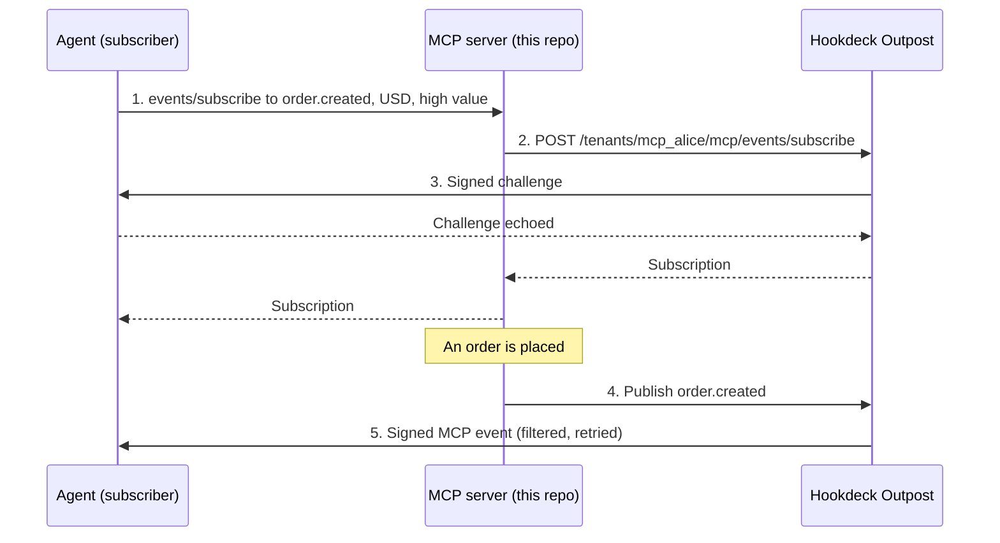
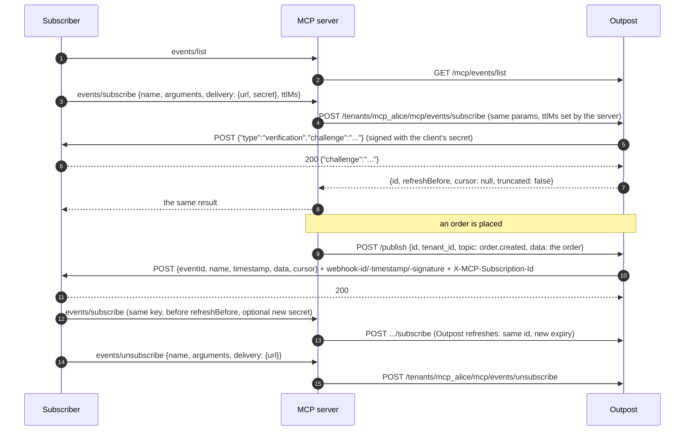

# MCP Events with Hookdeck Outpost

A working demo of an MCP server that offers [MCP Events](https://github.com/modelcontextprotocol/modelcontextprotocol/pull/3415) webhook delivery, with [Hookdeck Outpost](https://hookdeck.com/docs/outpost) running the subscriptions and delivering the events.

MCP Events is a draft MCP extension (SEP-3415) that lets an agent subscribe to events an MCP server exposes, such as a new order or a failed build, so it can react without a user in the loop. ChatGPT supports it in webhook mode ([OpenAI's implementer guide](https://developers.openai.com/plugins/build/mcp-events)). This repo is for MCP server builders who want to offer MCP Events without building the subscription and delivery side themselves.

Since v1.9.0, Outpost has [MCP Events support](https://hookdeck.com/docs/outpost/features/mcp-events) (experimental): it verifies each callback URL, stores the subscription, filters on its arguments, and signs and delivers each matching event. This server authenticates the agent, picks the Outpost tenant, forwards the three `events/*` methods, and publishes orders.

For a step-by-step walkthrough, read the guide [Send MCP Events Webhooks with Outpost](https://hookdeck.com/docs/outpost/guides/send-mcp-events-webhooks-with-outpost).

**Status:** demo code, not production-ready. Tested end to end on 2026-11-13 against a self-hosted Outpost v1.9.0, and with Outpost's MCP Events conformance check (`mcp-dev check`: 38 pass, 2 deliberate failures, see [Tests](#against-a-real-outpost)). Not yet re-tested with ChatGPT (see [ChatGPT and `webhook-id`](#chatgpt-and-webhook-id)) or against managed Outpost, where the MCP Events settings are rolling out. See [What's demo-only](#whats-demo-only).

The first version of this demo ran the verification challenge, expiry and filtering in the MCP server, on top of plain Outpost webhook destinations. It works with any Outpost version and was tested with ChatGPT and managed Outpost in October 2026. It's kept at the [`diy-webhook-destinations`](https://github.com/hookdeck/mcp-events-outpost-demo/tree/diy-webhook-destinations) tag.

## How it works

1. **An agent subscribes.** It calls `events/subscribe` on the MCP server with the event it wants (`order.created`), optional arguments (high-value orders in USD), a callback URL, and a signing secret it chose.
2. **The server forwards it to Outpost.** It authenticates the agent, maps it to an Outpost tenant, applies its subscription lifetime policy, and forwards the request to Outpost's subscribe endpoint.
3. **Outpost checks the agent wants the deliveries.** It POSTs a signed challenge to the callback URL, and the agent echoes it back. Outpost then stores the subscription and answers; the server returns that answer to the agent.
4. **Something happens.** When an order is placed, the server publishes it to Outpost.
5. **Outpost delivers it.** Outpost matches the order against each subscription's arguments, wraps it in the MCP event envelope, signs it (Standard Webhooks), delivers it, and retries. The agent verifies the signature and acts.

The agent refreshes its subscription before it expires, and unsubscribes when it's done. Outpost handles both, and expires subscriptions that lapse.



The quickstart uses a test subscriber (`src/client/`) as the agent.

## Quickstart

### Prerequisites

- Node.js 22 or later.
- Outpost v1.9.0 or later with MCP Events on, and its API key:
  - **Self-hosted:** set `EXPERIMENTAL_MCP_ENABLED=true`, `EXPERIMENTAL_MCP_EVENTS_SCHEMA` to the path of this repo's [`mcp-events.json`](mcp-events.json), and add `order.created` to `TOPICS`. See [Outpost's configuration reference](https://hookdeck.com/docs/outpost/self-hosting/configuration#mcp-events-experimental).
  - **Managed:** a Hookdeck Outpost project, and an API key from the project's **Settings > Secrets**. Step 2 turns MCP Events on.

### 1. Install and configure

```sh
npm install
cp .env.example .env    # then set OUTPOST_API_KEY, and OUTPOST_API_BASE_URL for self-hosted Outpost
```

### 2. Check Outpost

```sh
npm run outpost:check
```

It calls `GET /mcp/events/list` and reports whether MCP Events is on and offers `order.created`. On managed Outpost, `npm run outpost:check -- --apply` turns MCP Events on, sets the event definitions from `mcp-events.json`, and adds `order.created` to the project's topics, through the Config API. Saving restarts the deployment, so run the check again a minute later.

### 3. Run it

Outpost has to reach the subscriber's receiver, so the receiver needs a URL Outpost can connect to. Outpost only delivers to `https` URLs on public addresses, so use a tunnel. Use four terminals:

```sh
npm run tunnel                                   # 1. public URL for the receiver
npm run server                                   # 2. the MCP server
npm run client -- --currency USD --high-value    # 3. the test subscriber
```

Then place some orders in a fourth terminal:

```sh
npm run order -- --total 150 --currency USD    # delivered
npm run order -- --total 20 --currency USD     # filtered out by Outpost
npm run order -- --total 500 --currency EUR    # filtered out by Outpost
```

The client output looks like this:

```text
[client] receiver listening on :4000, callback URL https://<random>.trycloudflare.com/mcp-events/...
[client] connected, protocol 2026-07-28
[client] events/list offers: order.created
[client] answered verification challenge (msg_verification_...)
[client] subscribed sub_..., refreshBefore 2026-11-13T19:06:53Z
[client] waiting for events. Place an order with `npm run order`. Ctrl+C to unsubscribe and exit.
[client] event order.created evt_ord_..._...: {"orderId":"ord_...","total":150,"currency":"USD","highValue":true,...}
```

Only the 150 USD order arrives.

To run without a tunnel against a self-hosted Outpost on the same machine, start Outpost with `EXPERIMENTAL_MCP_ALLOW_INSECURE_CALLBACKS=true` (development only) and allow the address Outpost reaches your machine at in `DESTINATIONS_PRIVATE_ADDRESS_ALLOWLIST`. With Outpost in Docker, set `PUBLIC_CALLBACK_URL=http://host.docker.internal:4000` for the client and allowlist the address `host.docker.internal` resolves to inside the container.

### 4. Stop

Press Ctrl+C in the client. It unsubscribes, and Outpost deletes the subscription. Then stop the tunnel and the server.

### Troubleshooting

- **`outpost:check` says MCP Events is off.** Outpost answers `404` on its MCP routes while `EXPERIMENTAL_MCP_ENABLED` isn't `true`, and before v1.9.0.
- **`outpost:check` says the definitions are invalid.** Outpost starts anyway and answers `503` on its MCP routes. Its logs name the event and the field.
- **`subscribe failed` with code `-32602`.** Outpost rejected the request: for example an `http` or private callback URL (start `npm run tunnel` before the client), an argument that isn't in `inputSchema`, or a malformed secret.
- **`subscribe failed` with code `-32027` (CallbackEndpointError).** Outpost couldn't complete the verification challenge; `data.reason` says why (for example `connection_refused` or `http_5xx`). Check the tunnel is still running. If it was killed without exiting cleanly, `.tunnel-url` may point at a dead URL: delete it and restart the tunnel.
- **Subscribed, but no events arrive.** Check the order matches the arguments you subscribed with: `--high-value` only matches orders of 100 or more.
- **`OUTPOST_API_KEY is not set`.** Copy `.env.example` to `.env` and set the key.

## Architecture

- `src/server/`: the MCP server (TypeScript, official MCP SDK v2, Streamable HTTP). One event type, `order.created`, from a fake demo store.
- `src/client/`: a test subscriber. An MCP client plus a webhook receiver that answers verification challenges and verifies deliveries with the `standardwebhooks` library.
- `mcp-events.json`: the event definitions, in the MCP `events/list` format, that Outpost serves.
- `test/`: unit tests and an end-to-end test that runs the whole flow offline against a mock Outpost.

The full message flow, including refresh and unsubscribe:



## What Outpost handles and what the server handles

Outpost handles:

- **The verification challenge.** A signed `verification` envelope to the callback URL, which must echo the challenge. A passed check is cached per tenant and callback URL.
- **Callback URL rules.** `https` only, public addresses only, no redirects, unless a self-hosted deployment allows insecure callbacks for development.
- **Subscription storage and identity.** The same tenant, event, arguments and callback URL always map to the same subscription `id`, so a repeated subscribe is a refresh.
- **Expiry.** Outpost grants the `ttlMs` it receives and stops delivering when it passes.
- **Filtering.** Each argument matches the top-level payload field of the same name, by equality.
- **Delivery.** The MCP event envelope, Standard Webhooks signatures with a fresh timestamp on every attempt, `X-MCP-Subscription-Id`, dual signatures for 24 hours after a refresh brings a new secret, and retries 1, 3, 5 and 5 minutes apart. A `410` or `413` isn't retried.
- **Errors.** Failures come back as a `422` with an `mcp_error` (a JSON-RPC error object), which the server returns as is.

This server handles, in [`src/server/subscriptions.ts`](src/server/subscriptions.ts) and [`src/server/outpost-mcp.ts`](src/server/outpost-mcp.ts):

- **Authentication and the tenant.** The agent never sends a tenant: the server maps the authenticated principal to the tenant `mcp_<principal>`.
- **The permission check.** MCP Events requires the server to check the caller may receive the event with those arguments. In this demo every principal may receive every order.
- **The lifetime policy.** Outpost grants `ttlMs` exactly (omitted means 24 hours, `null` means no expiry), so the server sets it before forwarding: `SUBSCRIPTION_DEFAULT_TTL_MS` when the client sends none, which ChatGPT doesn't, and the client's value clamped to `SUBSCRIPTION_MIN_TTL_MS` and `SUBSCRIPTION_MAX_TTL_MS` otherwise.
- **Publishing,** once per tenant (see below).

## Arguments are equality filters

An argument matches the payload field of the same name, by equality, and must be a string, number, integer or boolean. So `order.created` offers two arguments, declared in `inputSchema` in [`mcp-events.json`](mcp-events.json):

- `currency`: `USD`, `EUR` or `GBP`.
- `highValue`, a boolean the store sets on each order (`true` when the total is 100 or more), so a subscriber can ask for large orders. A range such as "a total of at least 100" can't be an argument, because there's no comparison operator.

Without an `inputSchema`, Outpost would offer every top-level string, number, integer or boolean field of the payload as an argument.

## Tenancy and publishing

Outpost's publish API takes exactly one `tenant_id`, and each principal is its own tenant. So when an order is placed, the demo store publishes one copy per tenant that has subscribed, and Outpost delivers each copy to that tenant's matching subscriptions. Outpost's idempotency key is the event ID across the whole project, so each tenant's copy gets its own ID (`evt_<orderId>_<tenant hash>`), which is also the `eventId` the subscriber sees.

The server keeps the list of tenants that have subscribed in `data/tenants.json`. A tenant whose subscriptions have ended stays listed, and publishing to it matches nothing. Outpost's `GET /tenants` could replace the file, since a tenant's `topics` include the events it has subscriptions to, but on self-hosted Outpost it needs Redis with RediSearch.

## ChatGPT and `webhook-id`

Outpost sets `webhook-id` to a random `msg_...` value per delivery (one event on one subscription), kept across retries, as SEP-3415 requires. OpenAI's implementer guide says `webhook-id` must equal the body's `eventId`, and clients built on earlier drafts may check that. So ChatGPT might not accept Outpost's deliveries yet. This version of the demo hasn't been tested with ChatGPT; the October test used the first version, where `webhook-id` equaled `eventId`.

Receivers should deduplicate on `webhook-id`. A receiver that deduplicates on `eventId` must scope it to the subscription (`X-MCP-Subscription-Id`), because one event is delivered once per matching subscription.

## Where SEP-3415 and OpenAI's guide differ

- **Error codes.** Outpost answers with SEP-3415's codes, for example `-32023` NotFound and `-32027` CallbackEndpointError. OpenAI's guide and the earlier design sketch use `-32011` and `-32015`. The server returns Outpost's.
- **Unsubscribing an unknown subscription.** Outpost answers NotFound. OpenAI says unsubscribe is idempotent, so the server returns a success instead.
- **`webhook-id`.** See [ChatGPT and `webhook-id`](#chatgpt-and-webhook-id).
- **Capability shape.** The server advertises `"events": {}` in `server/discover`, as OpenAI's guide shows.

## MCP protocol version and SDK

- SDK: `@modelcontextprotocol/server` 2.2.0, `@modelcontextprotocol/client` 2.2.0, `@modelcontextprotocol/node` 2.1.0, the v2 line of the official TypeScript SDK.
- Protocol: the server serves **2026-07-28** (what ChatGPT requires) through the SDK's `createMcpHandler`, which also answers `server/discover`.
- The SDK has no MCP Events support. The server declares `capabilities.events` (cast, because the SDK's capability type doesn't know it) and registers `events/list`, `events/subscribe` and `events/unsubscribe` as custom request handlers on the low-level `Server` that `McpServer` wraps. The test client reads `server/discover` directly, because the SDK's typed capabilities drop the unknown `events` key.

## Outpost SDK

- The demo store publishes with the [Outpost TypeScript SDK](https://www.npmjs.com/package/@hookdeck/outpost-sdk) (`outpost.publish`).
- The SDK has no methods for the MCP routes (as of 2.0.0), so [`src/server/outpost-mcp.ts`](src/server/outpost-mcp.ts) calls them with `fetch`, and `npm run outpost:check` does the same for `/mcp/events/list` and the Config API.

## Configuration

### The tunnel

`npm run tunnel` uses the [`cloudflared`](https://www.npmjs.com/package/cloudflared) package (a dev dependency), which downloads the `cloudflared` binary on first run. A quick tunnel needs no Cloudflare account and gets a random `https://<random>.trycloudflare.com` URL each time. The script writes that URL to `.tunnel-url` (gitignored) and removes it on exit. `npm run client` uses it when `PUBLIC_CALLBACK_URL` is empty.

The receiver has to answer the verification challenge with the challenge in its response body, so it needs a tunnel that passes the response through. An Event Gateway source answers with a fixed response, so `hookdeck listen` can't front the receiver, except through an `MCP_EVENTS` source, which answers the challenge itself (see `--callback-url` below). To expose the MCP server instead, for example so ChatGPT can connect to it, pass `--port`: `npm run tunnel -- --port 3000` prints the `/mcp` URL and doesn't touch `.tunnel-url`.

### Client options

| Flag | Effect |
|---|---|
| `--currency <ISO>` / `--high-value` | Subscription arguments |
| `--ttl-ms <n>` | Suggested lifetime. The server grants between `SUBSCRIPTION_MIN_TTL_MS` and `SUBSCRIPTION_MAX_TTL_MS` (1 minute and 1 hour by default) |
| `--rotate-secret` | Generate a new secret on every refresh, to watch dual-signed deliveries |
| `--skip-timestamp-check` | Accept deliveries older than 5 minutes (signatures are still verified) |
| `--keep-subscription` | Don't unsubscribe on exit, to watch Outpost expire the subscription |
| `--callback-url <url>` | Subscribe with this exact callback URL, for example an Event Gateway `MCP_EVENTS` source that answers the verification challenge and forwards deliveries to the receiver with `hookdeck listen`. The receiver then accepts deliveries on any path |
| `--secret <whsec_...>` | Use this signing secret instead of generating one (also `SUBSCRIBER_SECRET`), for example the secret the Event Gateway source is configured with. Can't be combined with `--rotate-secret` |
| `--debug` | Log every `webhook-signature` entry and whether it matches the current secret, the previous one, or neither |

### Environment variables

Everything is documented in [`.env.example`](.env.example). `MCP_TOKENS` maps demo bearer tokens to principals (`dev-token-alice=alice,dev-token-bob=bob`).

## Tests

```sh
npm test            # vitest: unit + end-to-end, offline
npm run typecheck   # tsc --noEmit
```

- `test/secret.test.ts`: `whsec_` validation (24 to 64 bytes, strict base64) and generation.
- `test/signing.test.ts`: signatures interoperate with the `standardwebhooks` library, including dual signatures during rotation, tampering, the 5-minute freshness window, and matching each signature entry to its secret.
- `test/tunnel-url.test.ts`: the `.tunnel-url` file the client reads when `PUBLIC_CALLBACK_URL` is empty.
- `test/e2e.test.ts`: the MCP server, the test subscriber, and `test/mock-outpost.ts`, a small HTTP server with Outpost's MCP routes and publish endpoint. The mock answers with the status codes and `mcp_error` bodies Outpost v1.9.0 answers, verifies callbacks, matches arguments and delivers signed envelopes. The test covers subscribe, the challenge, publish, signed delivery, verification, filtering, deduplication, forged and stale rejection, refresh with secret rotation and dual signing, unsubscribe, the lifetime policy, idempotency, and error passthrough.

### Against a real Outpost

Run the quickstart against Outpost v1.9.0 or later. For a conformance run, Outpost's repository has `mcp-dev check`, which runs SEP-3415's webhook flow against any MCP Events server. In publish mode it needs two bearer tokens that map to Outpost tenants of the same name, so start a second server with `MCP_TOKENS=chk=chk,chk-2=chk-2 OUTPOST_TENANT_PREFIX= PORT=3001`, then, from an Outpost checkout running `make up/mcp`:

```sh
make mcp/dev ARGS="check --server http://host.docker.internal:3001/mcp --publish-tenant chk --event order.created \
  --arguments '{\"currency\":\"USD\"}' --data '{\"currency\":\"USD\",\"total\":150}' --other-data '{\"currency\":\"EUR\",\"total\":20}' --wait 90s"
```

On 2026-11-13, against Outpost v1.9.0, 38 rules passed, including delivery, retries, signing, `webhook-id` per message, refresh with dual signing, unsubscribe and argument filtering. The rest:

- `subscribe.https-required` warns, because the local stack allows `http` callbacks for development.
- `headers.name-missing` fails: the server accepts `events/subscribe` without an `Mcp-Name` header, because the MCP SDK client doesn't send one for `events/*`. A header that disagrees with `params.name` is refused (`headers.name-mismatch` passes).
- `unsubscribe.not-found` fails: the server answers an unknown unsubscribe with success, as OpenAI's guide asks, instead of NotFound.

## What's demo-only

- **Bearer token auth.** `MCP_TOKENS` maps static tokens to principals. A real server uses OAuth, with the token's subject as the principal.
- **`ANONYMOUS_PRINCIPAL`.** Lets requests with no token act as one fixed principal, for clients that don't do OAuth yet, such as ChatGPT's **No Authentication** option. Anyone who can reach the server can then subscribe as that principal. Leave it empty outside a short test.
- **No permission model.** Every principal may receive every order.
- **The tenant list** is a JSON file (`data/tenants.json`). A real server would use its database.
- **`/demo/orders` is unauthenticated** and the orders live in memory.

## Project layout

```
mcp-events.json    event definitions Outpost serves (EXPERIMENTAL_MCP_EVENTS_SCHEMA)
src/
  shared/          secret validation and generation, Standard Webhooks signing, tunnel URL file
  server/
    index.ts       entry point (npm run server)
    app.ts         HTTP routing: /mcp (bearer auth), /demo/orders
    mcp.ts         MCP server: events capability, events/* handlers, get_order tool
    subscriptions.ts  tenant, permission check and lifetime policy, then a call to Outpost
    outpost-mcp.ts Outpost's MCP routes, and its errors as JSON-RPC errors
    events.ts      the order type
    identity.ts    tenant ID
    demo-store.ts  fake store that publishes order.created
    store.ts       the tenants that have subscribed
    errors.ts      JSON-RPC error codes
  client/
    index.ts       entry point (npm run client)
    subscriber.ts  MCP client + webhook receiver
scripts/
  order.ts         npm run order
  tunnel.ts        npm run tunnel (dev quick tunnel)
  outpost-check.ts npm run outpost:check
test/              unit tests, end-to-end test, mock Outpost
```

## License

[MIT](LICENSE)
